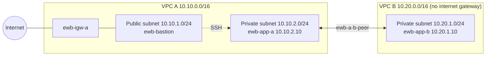

# ☁️ AWS VPC Peering Lab: Private Connectivity Between Two VPCs

A hands-on AWS networking lab that connects two separate Amazon VPCs with a **VPC peering connection**, so two private servers can talk to each other over private IPv4 addresses without using the public internet.

Full write-up with screenshots: [EWB_VPC_Peering_Report.pdf](EWB_VPC_Peering_Report.pdf)

## 📌 Project Overview

| Detail | Description |
|---|---|
| Project | AWS VPC Peering |
| Programme | EWB Courses, AWS Project 01 |
| Region | Asia Pacific (Sydney) |
| AWS Region Code | `ap-southeast-2` |
| Completion Date | 29 October 2026 |
| VPCs | 2 |
| Subnets | 3 |
| EC2 Instances | 3 (bastion, App-A, App-B) |
| Peering Connection | 1 active connection (`ewb-a-b-peer`) |
| Built with | AWS Management Console |

## 🎯 Objectives

- Connect two VPCs privately with a peering connection.
- Plan non-overlapping VPC and subnet CIDR ranges.
- Use public and private subnets with their own, explicitly associated route tables.
- Add routes in both directions, including the return path.
- Keep security group rules to single hosts (`/32`), with nothing open to `0.0.0.0/0`.
- Prove private connectivity with ping, and show that private hosts have no public IP.

## 🏗️ Architecture



VPC A is the only VPC with an internet gateway. VPC B has none, so it stays fully private. Peering does not let VPC B use VPC A's internet gateway.

## 📐 IP Address Plan

| Resource | VPC | IPv4 CIDR |
|---|---|---|
| `ewb-vpc-a` | VPC A | `10.10.0.0/16` |
| `ewb-public-subnet-a` | VPC A | `10.10.1.0/24` |
| `ewb-private-subnet-a` | VPC A | `10.10.2.0/24` |
| `ewb-vpc-b` | VPC B | `10.20.0.0/16` |
| `ewb-b-private` | VPC B | `10.20.1.0/24` |

## 🧰 AWS Services Used

- Amazon VPC (VPCs, subnets, route tables, internet gateway, peering)
- Amazon EC2 (instances, security groups)
- AWS Management Console

## ⚙️ Implementation Steps

1. **Create two VPCs:** `ewb-vpc-a` (`10.10.0.0/16`) and `ewb-vpc-b` (`10.20.0.0/16`), as VPC-only.
2. **Create the subnets:** public and private in VPC A, one private in VPC B, all in `ap-southeast-2a`.
3. **Attach an internet gateway** (`ewb-igw-a`) to VPC A only.
4. **Create route tables** and associate each subnet explicitly.
5. **Create the peering connection** `ewb-a-b-peer` (requester VPC A, accepter VPC B) and accept it.
6. **Add routes** for the peering connection on every route table.
7. **Launch EC2 instances:** a bastion in the public subnet, App-A and App-B with no public IPv4.
8. **Create security groups** with single-host rules.

### Route tables

| Route table | Destination | Target |
|---|---|---|
| `ewb-rt-a-public` | `10.10.0.0/16` | Local |
| `ewb-rt-a-public` | `0.0.0.0/0` | Internet gateway |
| `ewb-rt-a-public` | `10.20.0.0/16` | Peering connection |
| `ewb-rt-a-private` | `10.10.0.0/16` | Local |
| `ewb-rt-a-private` | `10.20.0.0/16` | Peering connection |
| `ewb-rt-b-private` | `10.20.0.0/16` | Local |
| `ewb-rt-b-private` | `10.10.0.0/16` | Peering connection (return path) |

### Security groups

| Security group | Protocol | Allowed source |
|---|---|---|
| `ewb-sg-bastion` | SSH, TCP 22 | My public IPv4 (`/32`) |
| `ewb-sg-app-a` | SSH, TCP 22 | Bastion private IP (`/32`) |
| `ewb-sg-app-a` | ICMP | App-B private IP (`/32`) |
| `ewb-sg-app-b` | SSH, TCP 22 | Bastion private IP (`/32`) |
| `ewb-sg-app-b` | ICMP echo request | App-A private IP (`/32`) |

## 🧪 Testing and Verification

```bash
# On App-A: forward path
ping -c 4 10.20.1.10

# On App-B: reverse path
ping -c 4 10.10.2.10
```

Private hosts were checked in the EC2 console: App-A and App-B show no public IPv4 address, only the bastion has one.

## 📊 Test Results

| Test | Result |
|---|---|
| Forward ping, App-A to App-B | 4 of 4 replies, 0% loss (screenshot in report) |
| Reverse ping, App-B to App-A | 4 of 4 replies, 0% loss (screenshot in report) |
| App-A and App-B have no public IPv4 | Confirmed (screenshots in report) |
| Baseline before peering | Not captured |
| SSH to App-B through ProxyJump | Not captured |
| Controlled ICMP failure and recovery | Not captured |

**Note:** ProxyJump from my Windows laptop failed with `Permission denied (publickey)`, so I reached the private hosts by connecting to the bastion and hopping from there with a copy of the key on it. The workbook recommends keeping the key on the laptop, so this is a deviation. Details are in the report.

## 🔐 Security Design

- Non-overlapping CIDRs, because AWS cannot peer overlapping VPCs.
- Only the bastion has a public IP; private hosts are reached through it.
- Every rule allows a single host (`/32`), nothing is open to `0.0.0.0/0`.
- Security groups are stateful, so replies need no extra inbound rule.

**Would tighten:** the App-A ICMP rule is "All ICMP" and should be Echo request only.

## 🧹 Cleanup

Order: terminate instances, delete the peering connection, delete security groups, detach and delete the internet gateway, delete subnets and route tables, delete both VPCs, delete the key pair.

## 💡 What I Learned

- Peering alone does not give connectivity: routes on both sides and the destination security group all have to allow the traffic.
- Active only means the link exists; the return route is just as important as the forward route.
- Peering is one-to-one and not transitive, and it does not share an internet gateway.
- Keep the private key on my laptop, and fix ProxyJump and key permissions instead of copying keys onto a bastion.

## 📄 License

MIT. See [LICENSE](LICENSE).
